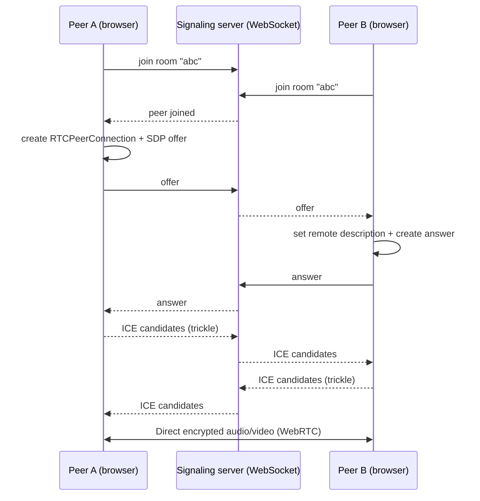

# PeerChat

A peer-to-peer, one-on-one video chat app. Media flows directly between browsers over **WebRTC**; a small **WebSocket** server is used only for signaling (room joining and the SDP/ICE handshake).

**Live demo:** https://peerchat-frontend-iota.vercel.app/


## Features

- One-on-one video and audio calls directly between browsers
- Room-based signaling: two users join the same room and are connected
- SDP offer/answer exchange over WebSockets
- Trickle ICE: candidates are sent as they are discovered, so calls connect faster

## How it works

WebRTC lets two browsers exchange media directly, but they first need a way to find each other and agree on connection details. That is the job of the signaling server.



1. Both users join the same room through the WebSocket server.
2. One peer creates an **SDP offer** and sends it through the server.
3. The other peer replies with an **SDP answer**.
4. Both peers exchange **ICE candidates** as they discover them (trickle ICE), probing for a working network path.
5. Once a path is found, audio and video flow **directly between the browsers**. The server never touches the media. WebRTC media is encrypted in transit (DTLS-SRTP).

## Tech stack

- **Frontend:** HTML, CSS, and vanilla JavaScript (no framework), deployed on Vercel
- **Backend:** Node.js WebSocket server for signaling

## Project structure

```
PeerChat/
├── backend/     # WebSocket signaling server
├── frontend/    # Web client (UI + WebRTC logic)
├── LICENSE
└── README.md
```

## Getting started

### Prerequisites

- Node.js and npm
- A browser with WebRTC support and a camera/microphone

### Run locally

```bash
# 1. Clone
git clone https://github.com/level-0-coder/PeerChat.git
cd PeerChat

# 2. Start the signaling server
cd backend
npm install
npm run dev

# 3. Start the frontend (new terminal)
cd ../frontend
python -m http.server
```

Then open the frontend URL in two browser tabs (or two devices) and join the same room.

> Note: browsers only allow camera access on `https://` pages or `localhost`, so test on other devices through a deployed HTTPS URL.

## Known limitations

- **No TURN server.** The app uses STUN only, so calls may fail between peers behind strict NATs, corporate firewalls, or some mobile networks.
- **One-on-one only.** Rooms are designed for two participants.

## License

Released under the [MIT License](./LICENSE).